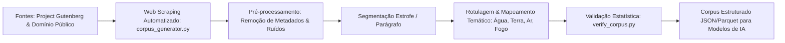

<div align="center">

# 📜 Pipeline de Web Scraping & NLP para Corpus Textual
### Observatório Brasileiro de Inteligência Artificial (OBIA) • UFPR

**Construção e Curadoria Automatizada de Corpus Textual para Benchmarking de Modelos de Embeddings**

[](https://python.org)
[](https://www.ufpr.br)
[](#)
[](#)

</div>

---

## 📌 Contexto da Pesquisa

Este projeto integra as pesquisas de Iniciação Científica (PIBIC) vinculadas ao **Observatório Brasileiro de Inteligência Artificial (OBIA)** da **Universidade Federal do Paraná (UFPR)**.

O objetivo da pesquisa é projetar pipelines computacionais para **coleta, limpeza, segmentação e rotulagem estruturada de textos literários clássicos** em domínio público, criando um corpus robusto para avaliação (*benchmarking*) de modelos contemporâneos de **embeddings textuais** e representações semânticas.

---

## 🔄 Arquitetura do Pipeline



---

## 📂 Estrutura do Repositório

```text
├── corpus_generator.py      # Coleta automatizada, limpeza e extração dos textos-fonte
├── verify_corpus.py         # Script de auditoria, contagem de tokens e verificação de integridade
├── sources.json             # Catálogo estruturado de URLs, autores e metadados das obras
├── data/                    # Textos brutos obtidos durante as etapas de scraping
└── output/                  # Corpus processado, normalizado e rotulado para os experimentos
```

---

## ✨ Funcionalidades Principais

- **Scraping Resiliente:** Tratamento de requisições, headers personalizados e paginação em bases de literatura aberta.
- **NLP e Higienização Avançada:** Remoção automática de prefácios, avisos de direitos autorais do Gutenberg, caracteres espúrios e normalização de quebras de linha poéticas.
- **Auditoria de Qualidade:** O script `verify_corpus.py` avalia métricas estatísticas (vocabulário único, distribuição de tamanho de estrofes e dispersão de classes).

---

## 🚀 Como Executar

```bash
git clone https://github.com/brunomarafiga/extracao_poemas.git
cd extracao_poemas
pip install requests beautifulsoup4 pandas
```

1. Para executar o pipeline de extração:
   ```bash
   python corpus_generator.py
   ```
2. Para auditar a integridade e gerar o relatório do corpus:
   ```bash
   python verify_corpus.py
   ```

---

<div align="center">
Desenvolvido por <strong>Bruno Marafiga</strong><br>
Pesquisador PIBIC • Observatório Brasileiro de Inteligência Artificial (OBIA / UFPR)
</div>
